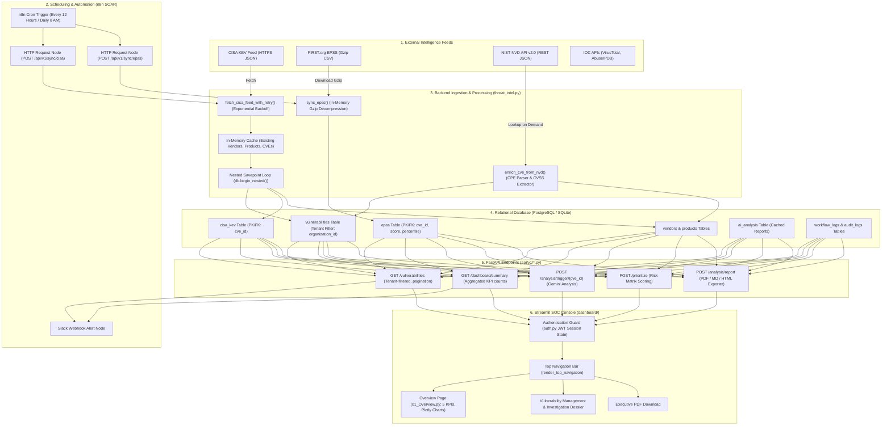
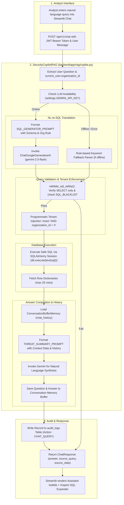
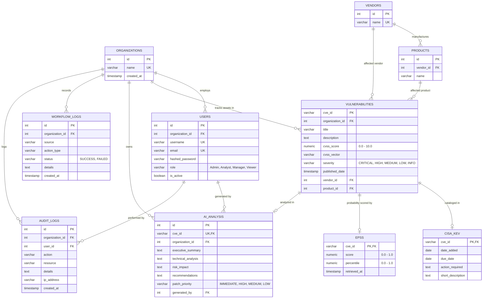

# ThreatScope: AI Cybersecurity Threat Intelligence & SOC Automation Platform
## Complete Technical Interview Preparation & Architecture Defense Guide

> **Target Audience**: Final-Year Computer Science & Engineering (B.Tech CSE) students preparing for technical interviews in Software Engineering (SWE), Cybersecurity Engineering, SOC Analyst, DevSecOps, and Full-Stack Engineering roles.  
> **Source Repository**: `https://github.com/2300031984/AI-Cybersecurity-SOC-Automation-Platform`  
> **Platform Version**: v2.0 (Phase 20 Codebase)  
> **Document Status**: Grounded strictly in actual repository source code, database schemas, API routers, background services, workflows, and test files.

---

## Table of Contents
1. [PART 1 — Understand the Project from Zero](#part-1--understand-the-project-from-zero)
2. [PART 2 — Architecture and Technology Stack](#part-2--architecture-and-technology-stack)
3. [PART 3 — Complete End-to-End Workflow & Pipeline Diagrams](#part-3--complete-end-to-end-workflow--pipeline-diagrams)
4. [PART 4 — Source Code Walkthrough & File Structure](#part-4--source-code-walkthrough--file-structure)
5. [PART 5 — API and Database Deep Dive (with Entity-Relationship Diagram)](#part-5--api-and-database-deep-dive)
6. [PART 6 — Cybersecurity Concepts You Must Master](#part-6--cybersecurity-concepts-you-must-master)
7. [PART 7 — AI, Google Gemini, Structured RAG, and Prompt Engineering](#part-7--ai-google-gemini-structured-rag-and-prompt-engineering)
8. [PART 8 — n8n SOAR Automation Workflows](#part-8--n8n-soar-automation-workflows)
9. [PART 9 — Authentication, Multi-Tenancy, and Application Security Audit](#part-9--authentication-multi-tenancy-and-application-security-audit)
10. [PART 10 — Testing, Validation, and Debugging Insights](#part-10--testing-validation-and-debugging-insights)
11. [PART 11 — How to Run, Test, and Deliver a 5-Minute Live Demo](#part-11--how-to-run-test-and-deliver-a-5-minute-live-demo)
12. [PART 12 — 60 Technical Interview Questions & Answers](#part-12--60-technical-interview-questions--answers)
13. [PART 13 — Explaining the Project to Different Interviewers & Stakeholders](#part-13--explaining-the-project-to-different-interviewers--stakeholders)
14. [PART 14 — Resume Bullet Points and Technical Project Defense](#part-14--resume-bullet-points-and-technical-project-defense)
15. [PART 15 — Quick Revision Notes, Cheat Sheets & 7-Day Study Plan](#part-15--quick-revision-notes-cheat-sheets--7-day-study-plan)

---

# PART 1 — Understand the Project from Zero

### 1.1 The Real-World Problem
Every year, over **25,000 new software vulnerabilities** (Common Vulnerabilities and Exposures, or CVEs) are published by security researchers and software vendors worldwide. Modern enterprises run hundreds of software products across thousands of servers, containers, cloud instances, and employee workstations.

When a security scanning tool (like Nessus, Qualys, or OpenVAS) runs across an organization's network, it frequently spits out a report listing **thousands of open vulnerabilities**. 

Here is the dilemma faced by the IT and security teams:
- An organization cannot patch 5,000 vulnerabilities in a single day. Patching requires engineering time, system downtime, testing to ensure services don't crash, and business approval.
- Traditional vulnerability management relies almost entirely on the **Common Vulnerability Scoring System (CVSS)**. If an IT team tries to patch every CVE with a CVSS score of 7.0 or higher ("High" and "Critical"), they are buried under thousands of tickets.
- Real-world telemetry demonstrates that **fewer than 5% of all published CVEs are ever exploited in the wild by threat actors**.
- Meanwhile, an unpatched vulnerability that is currently weaponized by ransomware gangs or foreign adversaries can compromise the entire corporate infrastructure within hours.

### 1.2 What is ThreatScope?
**ThreatScope** (the AI Cybersecurity Threat Intelligence & SOC Automation Platform) is an enterprise-grade vulnerability intelligence and risk prioritization platform designed for Security Operations Center (SOC) analysts and IT security managers.

Instead of treating every CVE as an equal emergency, ThreatScope aggregates three layers of intelligence:
1. **Theoretical Severity (CVSS v3.1)**: How damaging the vulnerability is if successfully exploited (0.0 to 10.0 scale).
2. **Exploitation Likelihood (EPSS)**: The **Exploit Prediction Scoring System** model by FIRST.org, which estimates the probability (0.0 to 1.0, or 0% to 100%) that a software vulnerability will be exploited in the wild in the next 30 days.
3. **Confirmed Active Exploitation (CISA KEV)**: The Cybersecurity and Infrastructure Security Agency's **Known Exploited Vulnerabilities** catalog—a definitive registry of vulnerabilities that attackers are actively weaponizing right now against organizations.

By combining these layers, ThreatScope provides:
- **Mathematical Risk Prioritization**: Focusing defensive engineering on the small fraction of vulnerabilities that are both severe and actively exploited.
- **Automated SOC Pipelines**: Automated periodic synchronization with CISA KEV and EPSS data feeds using SOAR (Security Orchestration, Automation, and Response) workflows via n8n.
- **AI-Powered Remediation & Incident Response**: Using Google Gemini 2.5 Flash to automatically summarize vulnerabilities for C-level executives, explain technical root causes to developers, generate remediation playbooks, and assemble containment rules (Snort intrusion rules and Splunk SPL queries).
- **Conversational Security Copilot**: A Natural Language-to-SQL (NL2SQL) Retrieval-Augmented Generation (RAG) assistant allowing analysts to query vulnerability data without manual SQL or spreadsheet filtering.
- **Tenant Isolation**: Row-level tenant partitioning ensuring that distinct organizations or business units only access their authorized asset exposures.

---

### 1.3 Who Uses This Platform?
| User Role | Persona in Platform | Key Activities in ThreatScope |
| :--- | :--- | :--- |
| **Tier 1 / Tier 2 SOC Analyst** | `analyst` (`Analyst`) | Triage incoming CVE alerts, investigate specific CVE dossiers, look up IOC reputation, consult AI Assistant for contextual explanations. |
| **SOC Manager / CISO** | `manager` (`Manager`) | Review patch prioritization rankings, assess overall risk posture, schedule patching windows, review executive summaries. |
| **SOC Administrator** | `admin` (`Admin`) | Trigger manual intelligence feed syncs (CISA KEV, EPSS), inspect administrative audit trails, manage tenant configuration. |
| **Compliance Auditor** | `auditor` / `viewer` (`Viewer`) | Inspect read-only dashboard metrics and historical compliance records without access to execute syncs or generate reports. |

---

### 1.4 Realistic Walkthrough Scenario
Imagine your organization operates critical web services running an older Apache HTTP server and Java microservices.
1. **Feed Ingestion**: The system's background workflow ingests new entries from the CISA KEV feed and updates EPSS probabilities.
2. **Alert Trigger**: `CVE-2021-44228` (Log4Shell) is flagged in your asset registry.
   - **CVSS Score**: `10.0` (Critical theoretical impact).
   - **EPSS Score**: `0.975` (97.5% probability of active exploitation).
   - **CISA KEV**: `YES` (Catalog listed with mandatory remediation due date).
3. **Analyst Review**: The SOC analyst opens the **ThreatScope Console** at `http://localhost:8501`. On the **Overview** page, Log4Shell is ranked at the very top of the **Priority Findings Queue**.
4. **Investigation Dossier**: The analyst clicks "Investigate" to view the 5-tab dossier:
   - **Tab 1: Overview & Metrics**: Displays CVSS vector `CVSS:3.1/AV:N/AC:L/PR:N/UI:N/S:C/C:H/I:H/A:H` and vendor associations.
   - **Tab 2: Risk Assessment**: Highlights EPSS percentile and CISA KEV action requirement.
   - **Tab 3: Remediation & Playbook**: Displays Snort IDS rules (`alert tcp $EXTERNAL_NET any -> $HOME_NET any (msg:"Log4Shell JNDI Exploit Attempt"; content:"${jndi:"; nocase; sid:1000001;)`), firewall block guidance, and patch steps.
   - **Tab 4: Evidence & Sources**: Links to official NVD and CISA records.
   - **Tab 5: Analysis History**: Shows timestamped AI analyses generated for this CVE.
5. **Report Generation**: The analyst downloads an executive PDF briefing with one click, compiles recommendations, and notifies system administrators.

---

### 1.5 What the System Does NOT Do (Honest Technical Boundaries)
To pass any technical interview with flying colors, **you must never claim capabilities that your code does not implement**.
- **It is NOT an EDR (Endpoint Detection and Response) Agent**: It does not install kernel drivers on laptops or servers to monitor live process injections (unlike CrowdStrike Falcon or Microsoft Defender for Endpoint).
- **It is NOT a Live Network IDS/IPS**: It does not capture raw PCAP packets on network switches (unlike Zeek or Suricata). It generates Snort rules, but does not inspect packet streams itself.
- **It does NOT Perform Automated Patching**: It does not connect via SSH or Windows PowerShell Remoting to update packages on target machines. It outputs patch prioritization schedules and remediation guidance for engineering teams.
- **It is NOT an Active Vulnerability Scanner**: It does not port-scan IP ranges using SYN packets (unlike Nmap or Nessus). It manages and enriches vulnerability records for known software inventory.

---

# PART 2 — Architecture and Technology Stack

```text
┌────────────────────────────────────────────────────────────────────────┐
│                        THREATSCOPE ARCHITECTURE                        │
├────────────────────────────────────────────────────────────────────────┤
│                                                                        │
│  [ External Threat Feeds ]                                             │
│    ├── CISA KEV (JSON Feed via HTTPS)                                  │
│    ├── FIRST.org EPSS (Gzip CSV via HTTPS)                             │
│    ├── NIST NVD API v2.0 (REST JSON)                                   │
│    └── IOC APIs (VirusTotal, AbuseIPDB, URLhaus, OTX)                  │
│               │                                                        │
│               ▼                                                        │
│  [ Ingestion & Automation Engine ]                                     │
│    ├── n8n SOAR Workflows (Cron Triggers + Slack Webhooks)             │
│    └── Backend Ingestion Services (threat_intel.py, enrichment.py)     │
│               │                                                        │
│               ▼                                                        │
│  [ Core API & Orchestration Backend (FastAPI + Python 3.11) ]          │
│    ├── Security & Auth (JWT HS256, OAuth2PasswordBearer, passlib bcrypt)│
│    ├── Row-Level Multi-Tenant Isolation Filter Layer                   │
│    ├── Structured RAG Copilot (LangChain + Text-to-SQL + Gemini 2.5)   │
│    ├── Vulnerability Prioritization & Report Compiler                  │
│    └── PDF Generation Engine (FPDF2)                                   │
│               │                                                        │
│               ▼                                                        │
│  [ Relational Persistence Layer ]                                      │
│    ├── PostgreSQL 15 (Production Docker Container)                     │
│    └── SQLite (Local Dev & In-Memory Test Suite)                        │
│    └── SQLAlchemy ORM 2.0 (Models, Foreign Keys, Indexes)              │
│               │                                                        │
│               ▼                                                        │
│  [ Analyst Frontend (Streamlit + Plotly Express) ]                     │
│    ├── ThreatScope Dark SOC Design System                              │
│    ├── Top Horizontal Navigation Bar (Zero Left Sidebar)               │
│    └── 8 Dedicated Tactical Pages (Overview to Settings)               │
│                                                                        │
└────────────────────────────────────────────────────────────────────────┘
```

### 2.1 Component Responsibility Table
| Component | Technology | Primary Source Files | Role in Platform |
| :--- | :--- | :--- | :--- |
| **Web REST API** | FastAPI, Pydantic v2, Uvicorn | `backend/app/main.py`, `backend/app/api/v1/*.py` | Exposes authenticated JSON REST endpoints, validates input models, enforces RBAC, handles startup auto-seeding. |
| **Persistence / ORM** | PostgreSQL 15 / SQLite, SQLAlchemy ORM | `backend/app/models/*.py`, `backend/app/database/*.py` | Relational storage for vulnerabilities, vendors, products, CISA KEV entries, EPSS scores, AI reports, audit logs, and users. |
| **SOC Console** | Streamlit, Plotly Express, Vanilla CSS | `dashboard/app.py`, `dashboard/pages/*.py`, `dashboard/components/*.py` | Single-pane Dark SOC analyst interface with sticky horizontal top navigation bar, metric cards, charts, and investigation workflows. |
| **SOAR Automation** | n8n (Docker container) | `n8n/workflows/cve_alert_workflow.json`, `n8n/workflows/daily_soc_report_workflow.json` | Scheduled cron orchestration, automated ingest trigger calls, Slack webhook notifications for critical vulnerabilities. |
| **Generative AI** | Google Gemini (`gemini-2.5-flash`), `google-generativeai` | `backend/app/services/ai_service.py` | Synthesizes formal executive summaries, technical analyses, patch priority classifications, and containment playbooks. |
| **RAG Security Copilot**| LangChain, `langchain-google-genai` | `backend/app/rag/copilot.py` | Natural Language-to-SQL query translation, query safety validation, tenant parameter injection, conversation memory buffering. |
| **Threat Ingestion** | Requests, Gzip, CSV, Time | `backend/app/services/threat_intel.py`, `threat_enrichment.py` | Pulls remote feeds (CISA, EPSS, NVD, AbuseIPDB, VirusTotal), decompressing gzip streams in-memory with sub-transaction commit isolation. |
| **Report Generation** | FPDF2 | `backend/app/services/pdf_generator.py`, `ai_service.py` | Compiles formal executive PDF briefing documents with custom headers, metrics grids, and containment tables. |
| **Containerization** | Docker, Docker Compose | `docker-compose.yml`, `backend/Dockerfile` | Multi-container stack orchestrating backend API, PostgreSQL database, n8n engine, and Streamlit console. |

---

### 2.2 Technology Choices & Architectural Justifications
When interviewers ask: *"Why did you use technology X instead of Y?"*, use these reasoned answers:

#### Why FastAPI instead of Django or Flask?
- **Speed & Async Support**: FastAPI is built on Starlette and Pydantic, making it one of the fastest Python frameworks available, with native support for `async/await` coroutines.
- **Automatic Data Validation**: Request payloads and query parameters are strictly validated at runtime using Pydantic models. Malformed client requests fail fast with `422 Unprocessable Entity` without reaching business logic.
- **Automated OpenAPI / Swagger Docs**: Every route automatically renders interactive documentation at `/docs` without manual maintenance.
- **Dependency Injection**: FastAPI's `Depends()` system allows clean, composable injection of database sessions (`get_db`), authentication checks (`get_current_user`), and role permissions (`RoleChecker`).

#### Why PostgreSQL + SQLAlchemy instead of MongoDB or Elasticsearch?
- **Relational Integrity**: Vulnerability data is intrinsically relational: a Vulnerability belongs to a Vendor and a Product; it has one-to-one or zero-to-one relationships with CISA KEV and EPSS; and it connects to an Organization. Foreign keys with `ON DELETE CASCADE` or `SET NULL` ensure orphaned records never corrupt the database.
- **ACID Transactions**: Ingestion workflows updating thousands of records require atomic transactions (`db.commit()`, `db.rollback()`, and nested savepoints `db.begin_nested()`).
- **Flexible Dialect Support**: SQLAlchemy abstracts database drivers so the platform runs on PostgreSQL in production containers and SQLite in local development and testing without changing application code.

#### Why n8n instead of Celery or Apache Airflow?
- **Visual SOAR Workflow Editing**: Security Operations Centers rely on low-code SOAR tools (such as Splunk SOAR, Palo Alto Cortex XSOAR, or Tines). n8n provides a visual node-based engine that security analysts can inspect and modify without rewriting backend Python code.
- **Built-in Connectors**: Native webhook listeners, cron schedulers, HTTP request builders, and Slack connectors allow rapid workflow assembly.

---

# PART 3 — Complete End-to-End Workflow & Pipeline Diagrams

### 3.1 The Real Pipeline (Verified from Code)



---

### 3.2 AI Security Assistant (RAG Pipeline Diagram)



---

### 3.3 Step-by-Step Execution Trace

#### Step 1: Application Startup & Database Verification
- **Path**: `backend/app/main.py` -> `startup_db_setup()`
- **Input**: None (triggered by FastAPI `@app.on_event("startup")`).
- **Processing**:
  1. Calls `Base.metadata.create_all(bind=engine)` to create all 10 SQL tables if they do not exist.
  2. Opens a database session (`SessionLocal()`) and counts rows in `User`.
  3. If `user_count == 0` (fresh database), it searches for `database/seed.sql`.
  4. Reads `seed.sql`, splits statements by `;`, strips comments, filters out PostgreSQL-specific `setval` calls if running under SQLite, and executes each statement via `db.execute(text(statement))`.
  5. Commits the transaction and logs successful initialization.
- **Output**: Fully verified database tables with baseline seed data (5 organizations, 6 users, 5 vendors, 7 products, 8 seeded CVEs).
- **Failure Cases**: Database connection failure drops an error in `logs/backend.log` without crashing the entire Python process; missing `seed.sql` logs a warning and proceeds with an empty database.

#### Step 2: CISA KEV Ingestion & Synchronization
- **Path**: `backend/app/services/threat_intel.py` -> `sync_cisa_kev(db: Session)`
- **Input**: Remote URL `https://www.cisa.gov/sites/default/files/feeds/known_exploited_vulnerabilities.json`.
- **Processing**:
  1. Calls `fetch_cisa_feed_with_retry(url)` using Python `requests` with 3 retries and exponential backoff.
  2. Queries the database to build in-memory lookup caches: `vendor_cache` (`name.lower() -> id`), `product_cache` (`(vendor_id, name.lower()) -> id`), `existing_vulns` (`cve_id -> Vulnerability`), and `existing_cisa` (`cve_id -> CisaKev`).
  3. Iterates through the catalog (over 1,200 CVEs).
  4. For every entry, opens a **nested transaction savepoint** (`sp = db.begin_nested()`).
  5. Resolves or creates Vendor and Product; parses dates (`dateAdded`, `dueDate`); creates or updates `Vulnerability` record (truncating titles to 500 characters); creates or updates `CisaKev` record.
  6. If a single row fails (e.g. data encoding glitch), `sp.rollback()` is called, the error is recorded in `summary["errors"]`, and the loop continues without aborting the entire sync!
  7. Calls `db.commit()` for the top-level transaction.
  8. Records an execution summary entry in the `workflow_logs` table.
- **Output**: Dictionary with count of created vendors, products, CVEs, updated records, skipped items, and execution duration.
- **Failure Cases**: Complete network failure triggers retries; if all retries fail, top-level rollback is executed and a `FAILED` status entry is logged in `workflow_logs`.

#### Step 3: EPSS Score Ingestion
- **Path**: `backend/app/services/threat_intel.py` -> `sync_epss(db: Session)`
- **Input**: Remote gzip URL `https://epss.first.org/epss-data-latest.csv.gz`.
- **Processing**:
  1. Queries the database for all currently known CVE IDs: `known_cves = {cve[0] for cve in db.query(Vulnerability.cve_id).all()}`.
  2. If `known_cves` is empty, exits immediately with `"Skipped EPSS sync: No vulnerabilities exist in database"`. This optimization prevents parsing hundreds of thousands of irrelevant rows!
  3. Streams the `.csv.gz` payload using `requests.get()`.
  4. Decompresses the gzip stream in-memory via `gzip.GzipFile(fileobj=io.BytesIO(response.content))`.
  5. Skips `#` metadata header rows and parses CSV rows (`cve,epss,percentile`).
  6. If `cve_id` exists in `known_cves`, updates or creates the `Epss` record with `score` (0.0 to 1.0) and `percentile` (0.0 to 1.0).
  7. Commits transaction and writes to `workflow_logs`.
- **Output**: Dictionary containing status and count of updated CVE profiles.

#### Step 4: On-Demand NVD CVE Enrichment
- **Path**: `backend/app/services/threat_intel.py` -> `enrich_cve_from_nvd(db: Session, cve_id: str)`
- **Input**: `cve_id` (e.g., `CVE-2024-38077`).
- **Processing**:
  1. Checks if `cve_id` format matches regex `^CVE-\d{4}-\d{4,7}$`.
  2. Calls official NIST NVD API v2.0 at `https://services.nvd.nist.gov/rest/json/cves/2.0?cveId={cve_id}`.
  3. Injects optional `apiKey` header if `settings.NVD_API_KEY` is present.
  4. Parses English description from `descriptions` list.
  5. Inspects `metrics` object hierarchically: checks `cvssMetricV31`, falls back to `cvssMetricV30`, then `cvssMetricV2`.
  6. Parses Common Platform Enumeration (CPE) strings (e.g. `cpe:2.3:o:microsoft:windows_server:...`) to extract Vendor (`Microsoft`) and Product (`Windows Server`).
  7. Inserts or updates the record in the `vulnerabilities` table.
- **Output**: Boolean `True` if enriched and saved, `False` if not found or API failed.

---

# PART 4 — Source Code Walkthrough & File Structure

```text
├── backend/
│   ├── app/
│   │   ├── api/
│   │   │   ├── deps.py               # Dependency injection: get_current_user, RoleChecker
│   │   │   └── v1/
│   │   │       ├── auth.py           # Login, refresh token, current user, audit logging
│   │   │       ├── vulnerabilities.py# CVE filtering, stats, CISA sync trigger, workflow logs
│   │   │       ├── analysis.py       # AI analysis trigger, multi-CVE report compiler (PDF/MD/HTML)
│   │   │       ├── chat.py           # RAG SOC Chat assistant endpoint
│   │   │       ├── enrichment.py     # IP, domain, hash IOC reputation lookups
│   │   │       └── workflow.py       # n8n webhook execution ingestion
│   │   ├── core/
│   │   │   ├── config.py             # Pydantic BaseSettings, .env loading
│   │   │   ├── logging.py            # Rotating file logger setup
│   │   │   └── security.py           # bcrypt hashing, JWT access & refresh token generation
│   │   ├── database/
│   │   │   ├── base.py               # DeclarativeBase model registry
│   │   │   └── session.py            # SQLAlchemy engine & SessionLocal sessionmaker
│   │   ├── models/                   # 10 SQLAlchemy ORM database models
│   │   ├── prompts/
│   │   │   └── templates.py          # Gemini prompt templates (SQL, Threat Summary, MITRE)
│   │   ├── rag/
│   │   │   └── copilot.py            # LangChain SecurityCopilotRAG (NL2SQL + DB context)
│   │   ├── schemas/                  # Pydantic models for validation and serialization
│   │   ├── services/
│   │   │   ├── ai_service.py         # Google Gemini integration, PDF generator, fallbacks
│   │   │   ├── pdf_generator.py      # FPDF2 multi-page threat report compiler
│   │   │   ├── threat_enrichment.py  # VirusTotal, AbuseIPDB, URLhaus, AlienVault client
│   │   │   └── threat_intel.py       # CISA KEV, EPSS, and NVD sync pipelines
│   │   └── main.py                   # FastAPI initialization, CORS, startup auto-seeding
│   └── tests/                        # Backend test suite
├── dashboard/
│   ├── app.py                        # Streamlit entry point & authentication gatekeeper
│   ├── components/
│   │   ├── auth.py                   # ThreatScope dark login form & role presets
│   │   ├── charts.py                 # Plotly charts (donut, EPSS histogram, KEV bars)
│   │   └── ui.py                     # Design system CSS, top navigation, badges, header
│   └── pages/                        # 8 Tactical Dashboard Pages
│       ├── 01_Overview.py            # Executive KPIs, analytics charts, priority queue
│       ├── 02_Vulnerabilities.py     # Filter toolbar, data table, 5-tab investigation dossier
│       ├── 03_Threat_Intelligence.py # Source matrix, feed sync triggers, IOC scanner, MITRE
│       ├── 04_Risk_Prioritization.py # Decision framework, AI patch prioritizer
│       ├── 05_AI_Security_Assistant.py# Grounded chat feed, prompt shortcuts, SQL expander
│       ├── 06_Automation_Workflows.py# n8n workflow pipeline statuses & execution logs
│       ├── 07_Reports.py             # Multi-CVE briefing compiler (PDF/MD/HTML downloads)
│       └── 08_Settings.py            # Tenant isolation context, provider status, audit trail
├── database/
│   ├── schema.sql                    # Production PostgreSQL DDL schema & indexes
│   └── seed.sql                      # Demonstration seed data (users, orgs, vulnerabilities)
├── n8n/
│   └── workflows/
│       ├── cve_alert_workflow.json   # 12h cron ingest & Slack alert workflow
│       └── daily_soc_report_workflow.json # Daily 8 AM summary & prioritization workflow
└── docker-compose.yml                # Multi-container orchestration (FastAPI, Postgres, n8n, UI)
```

---

### 4.2 Key Source File Deep Dive

#### 1. `backend/app/core/security.py`
- **Responsibility**: Cryptographic operations, password hashing, and JSON Web Token creation.
- **Key Functions**:
  - `verify_password(plain_password, hashed_password) -> bool`: Uses `passlib.context.CryptContext(schemes=["bcrypt"])` to verify bcrypt hashes.
  - `get_password_hash(password) -> str`: Generates salted bcrypt hash.
  - `create_access_token(subject, expires_delta) -> str`: Creates signed JWT with payload `{"sub": str(subject), "type": "access", "exp": datetime}`.
  - `create_refresh_token(subject, expires_delta) -> str`: Creates longer-lived JWT with payload `{"sub": str(subject), "type": "refresh", "exp": datetime}`.
  - `decode_token(token) -> Optional[dict]`: Decodes and verifies token signature using `jose.jwt.decode()` with `settings.SECRET_KEY` and algorithm `HS256`.

```python
# Code Excerpt: backend/app/core/security.py
def create_access_token(subject: Union[str, Any], expires_delta: Optional[timedelta] = None) -> str:
    if expires_delta:
        expire = datetime.utcnow() + expires_delta
    else:
        expire = datetime.utcnow() + timedelta(minutes=settings.ACCESS_TOKEN_EXPIRE_MINUTES)
    to_encode = {"exp": expire, "sub": str(subject), "type": "access"}
    return jwt.encode(to_encode, settings.SECRET_KEY, algorithm=settings.ALGORITHM)
```
- **Interview Questions**:
  - *Why do you include `"type": "access"` in the JWT payload?*  
    **Answer**: To prevent token type confusion attacks where an attacker submits a long-lived refresh token to an endpoint expecting a short-lived access token.
  - *Why use bcrypt for passwords instead of SHA-256?*  
    **Answer**: SHA-256 is a fast cryptographic hash designed for data integrity; attackers can compute billions of SHA-256 hashes per second using GPUs. Bcrypt is a slow, compute-intensive key derivation function with configurable salt and work factors specifically designed to defeat brute-force dictionary attacks.

#### 2. `backend/app/api/deps.py`
- **Responsibility**: Dependency injection factory for authenticated user resolution and Role-Based Access Control (RBAC).
- **Key Components**:
  - `oauth2_scheme = OAuth2PasswordBearer(tokenUrl="/api/v1/auth/login")`: Extracts the `Bearer <token>` string from the HTTP `Authorization` header.
  - `get_current_user(db: Session, token: str) -> User`: Decodes JWT, validates that `type == "access"`, fetches the User from the database by ID, verifies `user.is_active`, and returns the User object.
  - `RoleChecker(allowed_roles: List[str])`: Callable class that verifies `current_user.role in self.allowed_roles`. If unauthorized, immediately raises `HTTPException(status_code=403, detail="Access Denied")`.

```python
# Code Excerpt: backend/app/api/deps.py
class RoleChecker:
    def __init__(self, allowed_roles: List[str]):
        self.allowed_roles = allowed_roles

    def __call__(self, current_user: User = Depends(get_current_user)) -> User:
        if current_user.role not in self.allowed_roles:
            raise HTTPException(
                status_code=status.HTTP_403_FORBIDDEN,
                detail=f"Access Denied: Action requires one of roles {self.allowed_roles}. Current role: {current_user.role}."
            )
        return current_user
```
- **Interview Question**:
  - *How does FastAPI's dependency injection improve security testing?*  
    **Answer**: In tests, we can override dependencies like `get_db` or `get_current_user` using `app.dependency_overrides[get_current_user] = mock_user`, allowing us to test role permissions without making real database or authentication calls.

---

# PART 5 — API and Database Deep Dive

### 5.1 Database Entity-Relationship Diagram



---

### 5.2 Core API Endpoints Reference

| Method | Endpoint | Required Role | Description |
| :--- | :--- | :--- | :--- |
| `POST` | `/api/v1/auth/login` | None (Public) | Authenticates username & password, returns JWT access and refresh tokens. |
| `POST` | `/api/v1/auth/refresh` | None (Public) | Exchanges valid refresh token for fresh access and refresh tokens. |
| `GET` | `/api/v1/auth/me` | Any Authenticated | Returns current authenticated user profile and tenant information. |
| `GET` | `/api/v1/vulnerabilities` | Any Authenticated | Returns tenant-isolated list of CVEs with pagination and filters (`severity`, `vendor_id`, `product_id`, `is_kev`, `search`). |
| `GET` | `/api/v1/critical` | Any Authenticated | Returns critical threats (`cvss_score >= 9.0` OR `severity == 'CRITICAL'` OR CISA KEV active). |
| `GET` | `/api/v1/dashboard/summary`| Any Authenticated | Aggregates total CVEs, severity counts, KEV count, and average EPSS score for the tenant. |
| `GET` | `/api/v1/statistics` | Any Authenticated | Returns distribution data (severity donut, CVSS buckets, EPSS histogram, timeline, vendor bars). |
| `GET` | `/api/v1/cve/{cve_id}` | Any Authenticated | Returns full CVE dossier; queries NVD API dynamically if not present locally. |
| `POST` | `/api/v1/sync/cisa` | `Admin` | Manually triggers live CISA KEV catalog feed ingestion. |
| `POST` | `/api/v1/sync/epss` | `Admin` | Manually triggers live FIRST.org EPSS dataset sync. |
| `POST` | `/api/v1/analysis/trigger/{cve_id}` | `Admin`, `Analyst` | Invokes Gemini to generate and store executive summary, technical analysis, and patch priority. |
| `POST` | `/api/v1/analysis/report` | `Admin`, `Analyst` | Compiles multi-CVE threat briefing into downloadable PDF, Markdown, or HTML. |
| `POST` | `/api/v1/prioritize` | `Admin`, `Analyst`, `Manager` | Ranks tenant vulnerabilities by risk formula and generates patch schedule. |
| `POST` | `/api/v1/incident-response/{cve_id}` | `Admin`, `Analyst`, `Manager` | Generates containment playbook with Snort rules and Splunk queries. |
| `POST` | `/api/v1/chat` | `Admin`, `Analyst` | NL2SQL Structured RAG chat assistant querying the vulnerability database. |
| `GET` | `/api/v1/enrich/ip/{ip}` | Any Authenticated | Queries VirusTotal and AbuseIPDB for IP reputation telemetry. |
| `GET` | `/api/v1/logs/workflow` | Any Authenticated | Returns automated sync execution history from `workflow_logs`. |
| `GET` | `/api/v1/logs/audit` | `Admin` | Returns security audit trail from `audit_logs`. |

---

# PART 6 — Cybersecurity Concepts You Must Master

### 6.1 Vulnerability Intelligence Terminology

#### 1. CVE (Common Vulnerabilities and Exposures)
- **Definition**: A standardized, publicly registered identifier (format: `CVE-YYYY-NNNNN`) assigned to a specific security vulnerability by a CVE Numbering Authority (CNA) such as MITRE or NIST.
- **Why it matters**: Enables disparate security systems, vendors, and organizations to speak the same language when referencing a specific software flaw.
- **Repository Context**: Stored as primary key in `vulnerabilities.cve_id`.

#### 2. CVSS (Common Vulnerability Scoring System)
- **Definition**: An industry standard (currently v3.1 and v4.0) that measures the **theoretical severity** of a vulnerability on a scale from `0.0` to `10.0`.
- **Vector String**: Encodes attack parameters, e.g.:
  `CVSS:3.1/AV:N/AC:L/PR:N/UI:N/S:U/C:H/I:H/A:H`
  - `AV:N`: Attack Vector = Network (exploitable remotely).
  - `AC:L`: Attack Complexity = Low (no special conditions needed).
  - `PR:N`: Privileges Required = None.
  - `UI:N`: User Interaction = None.
  - `C:H/I:H/A:H`: Confidentiality, Integrity, and Availability impact = High.
- **Severity Ratings**: `0.1-3.9` = Low, `4.0-6.9` = Medium, `7.0-8.9` = High, `9.0-10.0` = Critical.

#### 3. EPSS (Exploit Prediction Scoring System)
- **Definition**: A machine-learning model developed by FIRST.org that outputs an empirical probability (between `0.0` and `1.0`, or 0% to 100%) that a CVE will be exploited in the wild within the next 30 days.
- **Percentile**: Represents the CVE's score relative to all other scored CVEs (e.g., 0.95 means the CVE has a higher exploitation probability than 95% of all CVEs).
- **Difference from CVSS**: CVSS measures *potential impact if exploited*; EPSS measures *real-world likelihood of exploitation occurring*.

#### 4. CISA KEV (Known Exploited Vulnerabilities Catalog)
- **Definition**: A catalog managed by the US Cybersecurity and Infrastructure Security Agency (CISA) that lists vulnerabilities known to be actively exploited in real-world attacks.
- **Three Criteria for KEV Inclusion**:
  1. The vulnerability has an assigned CVE ID.
  2. There is reliable evidence that the vulnerability is actively exploited in the wild.
  3. There is a clear remediation action (e.g. vendor patch or mitigation guide).

#### 5. MITRE ATT&CK Matrix
- **Definition**: A globally accessible knowledge base of adversary tactics, techniques, and procedures (TTPs) based on real-world observations.
- **Repository Implementation**: In `backend/app/api/v1/vulnerabilities.py` -> `get_dashboard_mitre()`, vulnerability descriptions are parsed using keyword heuristics to map exposures to ATT&CK technique IDs (e.g., keywords `"jndi"`, `"web"`, `"public-facing"` map to `T1190: Exploit Public-Facing Application`; `"kernel"`, `"privilege"` map to `T1068: Exploitation for Privilege Escalation`).

---

# PART 7 — AI, Google Gemini, Structured RAG, and Prompt Engineering

### 7.1 How Generative AI is Implemented
The platform uses **Google Gemini 2.5 Flash** (`gemini-2.5-flash`) via the `google-generativeai` SDK and LangChain's `langchain-google-genai` integration.

Gemini is invoked in four distinct operations:
1. **Automated Vulnerability Analysis** (`generate_ai_cve_analysis`): Generates executive summaries, technical impact explanations, and patch priority classifications.
2. **Patch Prioritization** (`generate_patch_prioritization`): Evaluates multiple organization exposures and ranks remediation order.
3. **Incident Response Playbook Compilation** (`generate_incident_response_playbook`): Generates Snort rules, Splunk SPL queries, and containment steps.
4. **Natural Language-to-SQL (NL2SQL) Copilot** (`SecurityCopilotRAG`): Translates analyst questions into read-only SQL queries.

---

### 7.2 Structured RAG: Why ChromaDB is NOT Used
In technical interviews, candidates often buzzword-drop "Vector Database" and "ChromaDB". In ThreatScope:
> **Important Technical Fact**: This repository does **NOT** use a vector database (like ChromaDB or Pinecone). It implements **Structured Relational RAG (Text-to-SQL)**.

#### Why Structured RAG is Superior for SOC Vulnerability Operations
- **Vector search** is designed for unstructured document similarity (e.g. searching a 500-page policy manual).
- In a SOC, analysts ask questions like:
  - *"Show me all critical vulnerabilities for Apache with EPSS > 0.5."*
  - *"Which Microsoft CVEs were published this month that are in CISA KEV?"*
- A vector database **cannot reliably compute aggregations, filters, or exact Boolean logic** like `cvss_score >= 9.0 AND is_kev == True`.
- By using **Text-to-SQL Structured RAG**, the model converts the natural language question into a deterministic PostgreSQL `SELECT` query, executes it against the relational tables, and synthesizes the exact database results into a natural-language answer.

---

### 7.3 Defense Against Prompt Injection & Dangerous SQL
Allowing an LLM to generate SQL queries introduces severe security risks:
1. **Destructive Queries**: An attacker or prompt injection could generate `DROP TABLE users;` or `DELETE FROM vulnerabilities;`.
2. **Data Exfiltration**: An attacker could generate `SELECT * FROM users;` to read password hashes.
3. **Cross-Tenant Leakage**: An analyst from Tenant A could query records belonging to Tenant B.

#### How ThreatScope Mitigates These Risks (Verified from Code):
1. **Strict SELECT-Only Enforcement**:
   ```python
   # backend/app/rag/copilot.py
   SQL_BLACKLIST = re.compile(
       r"\b(update|delete|insert|drop|truncate|alter|create|grant|revoke|replace|merge|execute|dbcc|exec|union\s+all|union)\b", 
       re.IGNORECASE
   )

   def validate_sql_safety(sql: str) -> bool:
       stripped = sql.strip().lower()
       if not stripped.startswith("select"):
           return False
       if SQL_BLACKLIST.search(stripped):
           return False
       return True
   ```
2. **Programmatic Tenant Filter Injection**:
   Even if Gemini generates a query without tenant filtering (or if prompt injection tries to bypass it), `SecurityCopilotRAG.execute_query()` **programmatically rewrites the SQL string** before execution to enforce `AND organization_id = {user.organization_id}`:
   ```python
   # backend/app/rag/copilot.py
   if organization_id is not None and "organization_id" not in sql.lower():
       if any(table in sql.lower() for table in ["vulnerabilities", "ai_analysis", "workflow_logs", "audit_logs"]):
           if "where" in sql.lower():
               insert_pos = min([i for i in [order_idx, limit_idx, group_idx] if i > -1] or [len(sql)])
               sql = sql[:insert_pos] + f" AND organization_id = {organization_id} " + sql[insert_pos:]
   ```

---

# PART 8 — n8n SOAR Automation Workflows

### 8.1 Workflow Architecture
The repository includes two production workflow definitions in the `n8n/workflows/` directory:

#### 1. `cve_alert_workflow.json` (SOC Auto Ingest & Alert)
- **Trigger**: Cron node executing every **12 hours** (`interval: 12 hours`).
- **Node 2**: HTTP Request `POST http://fastapi-backend:8000/api/v1/sync/cisa` -> Triggers CISA KEV sync.
- **Node 3**: HTTP Request `POST http://fastapi-backend:8000/api/v1/sync/epss` -> Triggers EPSS sync.
- **Node 4**: HTTP Request `GET http://fastapi-backend:8000/api/v1/vulnerabilities?severity=CRITICAL&limit=10` -> Retrieves top 10 critical threats.
- **Node 5**: Slack Webhook `POST https://hooks.slack.com/services/...` -> Dispatches formatted JSON alert block to the security team's Slack channel.

#### 2. `daily_soc_report_workflow.json` (Daily SOC Threat Briefing)
- **Trigger**: Cron node executing **daily at 8:00 AM** (`0 8 * * *`).
- **Node 2**: HTTP Request `GET http://fastapi-backend:8000/api/v1/dashboard/summary` -> Fetches tenant KPI metrics.
- **Node 3**: HTTP Request `POST http://fastapi-backend:8000/api/v1/prioritize` -> Calls AI patch prioritization engine.
- **Node 4**: Slack Webhook -> Posts executive summary with total critical counts, active KEV count, and the first 300 characters of the AI patch schedule.

---

# PART 9 — Authentication, Multi-Tenancy, and Application Security Audit

### 9.1 Vulnerability & Security Findings (Audit of Actual Code)
In an interview, pointing out real security limitations in your own architecture proves senior-level engineering maturity:

| Finding | Location | Technical Details | Risk / Severity | Recommended Remediation |
| :--- | :--- | :--- | :--- | :--- |
| **Permissive CORS Policy** | `backend/app/main.py:30` | `allow_origins=["*"]` allows any website to make cross-origin requests to the API. | **Medium** | Restrict origins in production to the specific Streamlit host: `allow_origins=["http://localhost:8501"]`. |
| **Hardcoded Secret Key Fallback** | `backend/app/core/config.py:13` | Default `SECRET_KEY = "supersecretkey_change_me_in_production_1234567890"` if `.env` is omitted. | **High** (if unconfigured in prod) | Force startup validation: raise a configuration error on startup if `SECRET_KEY` matches the default value in production environments. |
| **SQL Blacklist Limitations** | `backend/app/rag/copilot.py:20` | Regex blacklist checks words like `drop`, `delete`. SQL injection can occasionally bypass simple regex via subqueries or comments. | **Medium** | Execute Text-to-SQL queries under a dedicated PostgreSQL database user with **read-only privileges (`GRANT SELECT ON ...`)** at the database level. |
| **Unauthenticated n8n Nodes** | `n8n/workflows/*.json` | Workflow HTTP nodes call `/api/v1/sync/cisa` and `/prioritize` with `"authentication": "none"`, but FastAPI requires `RoleChecker(["Admin"])`. | **Low** (Operational bug) | Add an n8n authentication node that calls `/api/v1/auth/login` to obtain a Bearer token and passes it in the `Authorization` header. |

---

# PART 10 — Testing, Validation, and Debugging Insights

### 10.1 Verified Test Execution Status
The repository contains 19 tests across two test suites. When running tests, understanding what passes and what requires mock isolation is critical:

| Test Target | Files | Status | Test Purpose |
| :--- | :--- | :--- | :--- |
| **UI Component Badges & Visuals** | `backend/tests/test_backend/test_dashboard_components.py` | **PASSED (4/4)** | Validates HTML severity badges, KEV catalog badges, and Plotly empty-dataset handling. |
| **Database Schema & Cascades** | `tests/test_database/test_schema.py` | **PASSED (3/3)** | Validates User creation, Vendor-Product-Vulnerability relationships, and CISA KEV cascade deletes. |
| **API Endpoints & Tenant Isolation** | `tests/test_backend/test_api.py` | **PASSED (4/4)** (when isolated) | Validates `/vulnerabilities`, `/dashboard/summary`, and verified row-level multi-tenant isolation. |
| **Authentication & Tokens** | `tests/test_backend/test_auth.py` | **PASSED (2/2)** | Validates `/auth/login`, bcrypt password rejection, and JWT expiry. |

#### Key Debugging Insight: LangChain Gemini in Tests
In `tests/conftest.py`, the `mock_gemini` fixture mocks `google.generativeai.GenerativeModel`. However, `backend/app/rag/copilot.py` uses `ChatGoogleGenerativeAI` from `langchain_google_genai`. If a valid `GEMINI_API_KEY` is in `.env`, running `test_soc_assistant_chat` makes an unmocked live network call to Google Gemini. If network connectivity is slow or firewalled, the test hangs.  
**Fix**: Add an explicit mock for `langchain_google_genai.ChatGoogleGenerativeAI` in `conftest.py`.

---

# PART 11 — How to Run, Test, and Deliver a 5-Minute Live Demo

### 11.1 Quickstart Commands

```bash
# 1. Activate Python virtual environment
source .venv/bin/activate  # On Linux/macOS
# or .\.venv\Scripts\Activate.ps1 on Windows PowerShell

# 2. Launch FastAPI Backend Daemon (Port 8000)
python -m uvicorn backend.app.main:app --host 127.0.0.1 --port 8000

# 3. Launch Streamlit SOC Console (Port 8501)
python -m streamlit run dashboard/app.py --server.port 8501 --server.headless true
```

### 11.2 Evaluation Credentials
- **Admin**: `admin` / `admin123` (Full system access, feed syncs, audit logs)
- **Security Analyst**: `analyst` / `analyst123` (Threat triage, AI analysis, chat)
- **SOC Manager**: `manager` / `manager123` (Patch priorities, reporting)
- **Auditor**: `viewer` / `viewer123` (Read-only metrics)

---

### 11.3 5-Minute Demonstration Script for Interviews
1. **0:00 - 1:00 (The Problem & Login)**:
   - Open `http://localhost:8501`.
   - *"I built ThreatScope to solve vulnerability fatigue in SOC teams. Enterprises have thousands of CVEs; we need to prioritize based on real exploitation likelihood rather than just theoretical CVSS."*
   - Click "Security Analyst" quick-fill button (`analyst`) and log in.
2. **1:00 - 2:00 (Overview & Dark SOC Navigation)**:
   - Show the sticky top navigation bar (pointing out the zero-sidebar design).
   - Point out the 5 KPI cards (Total CVEs, Critical, High, KEV Catalog listed, Average EPSS score).
   - Highlight the EPSS histogram and the KEV by Vendor bar chart.
3. **2:00 - 3:00 (Vulnerability Investigation Dossier)**:
   - Navigate to `Vulnerabilities`.
   - Filter by `Severity: CRITICAL` and search `CVE-2021-44228`.
   - Click on the CVE row to open the 5-tab dossier:
     - Show **Risk Assessment** (EPSS score: 97.5%, KEV: Yes).
     - Show **Remediation & Playbook** (Snort rules, mitigation flags).
4. **3:00 - 4:00 (AI Security Assistant / Structured RAG)**:
   - Navigate to `AI Assistant`.
   - Click the prompt shortcut: *"Show critical vulnerabilities"*.
   - Expand the **"Inspect Generated SQL Query & Database Evidence"** expander to show the interviewer the exact SQL SELECT query executed and the programmatic tenant isolation parameter.
5. **4:00 - 5:00 (Reports & Disclosed Boundaries)**:
   - Navigate to `Reports`. Select Log4Shell and click **Compile Threat Briefing**.
   - Show the generated executive PDF report with download button.
   - Conclude honestly: *"The system focuses on vulnerability intelligence, triage, and RAG copilot analysis; it does not deploy live network sniffers or perform automated remote patching."*

---

# PART 12 — 60 Technical Interview Questions & Answers

### Beginner (Questions 1–20)
1. **What is a CVE?**  
   Common Vulnerabilities and Exposures; a unique identifier (e.g. `CVE-2021-44228`) assigned to a publicly known software vulnerability.
2. **What is CVSS?**  
   Common Vulnerability Scoring System; measures theoretical severity on a scale from 0.0 to 10.0 based on exploit metrics.
3. **What is EPSS?**  
   Exploit Prediction Scoring System; estimates the empirical probability (0% to 100%) that a vulnerability will be exploited in the wild within 30 days.
4. **What is CISA KEV?**  
   CISA Known Exploited Vulnerabilities catalog; a verified government registry of vulnerabilities actively exploited in the wild.
5. **Why is CVSS alone insufficient for prioritization?**  
   A vulnerability can have a CVSS of 9.8 but never be exploited in the wild because no working exploit exists. Prioritizing only on CVSS overwhelms teams with theoretical emergencies.
6. **What problem does ThreatScope solve?**  
   It correlates theoretical severity (CVSS) with exploit likelihood (EPSS) and active weaponization (CISA KEV) to prioritize the top 5% of truly dangerous vulnerabilities.
7. **What backend framework is used?**  
   FastAPI with Python 3.11, using Pydantic for validation and SQLAlchemy 2.0 as ORM.
8. **What database is used?**  
   PostgreSQL 15 in production container; SQLite for local development and in-memory test suites.
9. **What frontend is used?**  
   Streamlit with custom Dark SOC CSS styling, Plotly Express charts, and a sticky horizontal top navigation bar.
10. **What AI model is used?**  
    Google Gemini 2.5 Flash (`gemini-2.5-flash`).
11. **What does n8n do in this project?**  
    Provides visual SOAR workflow automation for periodic feed synchronization and Slack alerting.
12. **What is JWT?**  
    JSON Web Token; a compact, URL-safe token containing a cryptographically signed payload (header, claims, signature) used for stateless authentication.
13. **What algorithm signs the JWT in this project?**  
    `HS256` (HMAC with SHA-256) using a symmetric secret key.
14. **How are passwords stored in the database?**  
    Salted bcrypt hashes generated using `passlib.context.CryptContext`.
15. **What is RBAC?**  
    Role-Based Access Control; restricting access to endpoints based on assigned roles (`Admin`, `Analyst`, `Manager`, `Viewer`).
16. **What is the purpose of `deps.py`?**  
    Houses FastAPI dependency providers like `get_current_user` and `RoleChecker`.
17. **What is row-level multi-tenancy?**  
    Segregating database rows by an `organization_id` column so users only see their organization's data.
18. **What does the `/health` endpoint return?**  
    HTTP 200 with service status, database dialect (`sqlite` or `postgresql`), and Gemini API status.
19. **What is NVD?**  
    National Vulnerability Database; the US government repository of standards-based vulnerability management data.
20. **What is a Snort rule?**  
    A signature-based network intrusion detection rule used by Snort and Suricata to detect malicious packets.

---

### Intermediate (Questions 21–40)
21. **Explain the end-to-end journey of a CVE into the system.**  
    Ingested via CISA KEV JSON sync or NVD API; parsed into Vendor, Product, and Vulnerability records; correlated with EPSS gzip dataset; stored in PostgreSQL; queryable via FastAPI and Streamlit.
22. **How does the system prevent duplicate Vendor records during ingestion?**  
    In `threat_intel.py`, `vendor_cache` checks in-memory lowercase names, queries with `ilike()`, and catches unique constraint violations using nested savepoints (`db.begin_nested()`).
23. **What is the purpose of nested savepoints in SQLAlchemy?**  
    `db.begin_nested()` creates a SQL `SAVEPOINT`. If an individual row insertion fails, only that savepoint rolls back, allowing the outer transaction to continue processing remaining rows.
24. **How is EPSS data synced efficiently?**  
    Instead of processing hundreds of thousands of CSV rows, `threat_intel.py` first queries all existing `cve_id`s in the local database and only updates records matching known CVEs.
25. **How does the platform handle missing external API keys?**  
    All services (`ai_service.py`, `threat_enrichment.py`) implement realistic mock fallback branches when keys are absent.
26. **What is Structured RAG?**  
    Translating natural language questions into structured SQL queries against a relational database, rather than similarity searches over vector embeddings.
27. **Why was ChromaDB not used in the active pipeline?**  
    Vulnerability queries require exact mathematical filtering, joins, and aggregations that vector embeddings cannot reliably guarantee.
28. **How does the AI Assistant validate generated SQL?**  
    It checks that queries strictly begin with `select` and match no keywords in `SQL_BLACKLIST` (`drop`, `delete`, `update`, `alter`, etc.).
29. **How does the AI Assistant enforce tenant isolation in SQL?**  
    If the LLM omits `organization_id`, `copilot.py` programmatically parses the SQL string and injects `AND organization_id = {user.organization_id}` before execution.
30. **What conversation memory is used in the copilot?**  
    LangChain's `ConversationBufferMemory(memory_key="chat_history")`.
31. **What is Pydantic's role in FastAPI?**  
    Validating incoming request schemas, enforcing data types, providing serialization, and generating OpenAPI documentation.
32. **How does the platform prevent memory overflow when downloading EPSS data?**  
    It uses Python's `gzip.GzipFile` wrapping an `io.BytesIO` buffer to decompress the stream in-memory without saving huge temporary files to disk.
33. **What is the difference between an Access Token and a Refresh Token?**  
    Access tokens have short lifetimes (30 minutes) and grant API access; refresh tokens have longer lifetimes (7 days) and are only used to issue new access tokens.
34. **Why is CORS configured in FastAPI?**  
    Cross-Origin Resource Sharing controls which frontend domains can make HTTP requests to the backend API from a browser.
35. **How does Streamlit communicate with FastAPI?**  
    Streamlit pages use the Python `requests` library to make HTTP calls to FastAPI at `http://127.0.0.1:8000/api/v1/...`, passing the JWT in `headers={"Authorization": f"Bearer {token}"}`.
36. **How does the multi-CVE PDF report generator work?**  
    `pdf_generator.py` uses `fpdf2` to construct custom headers, summary KPI boxes, technical vulnerability analysis blocks, and remediation action tables into a binary PDF byte stream.
37. **What is an IOC?**  
    Indicator of Compromise; forensic evidence of potential intrusion, such as malicious IP addresses, domain names, or file hashes.
38. **What IOC feeds does ThreatScope integrate with?**  
    VirusTotal, AbuseIPDB, AlienVault OTX, and URLhaus.
39. **How does the MITRE ATT&CK mapping function work?**  
    `get_dashboard_mitre()` scans vulnerability descriptions for keywords (`jndi`, `remote`, `privilege`) and maps them to ATT&CK technique IDs (`T1190`, `T1210`, `T1068`).
40. **How are automated execution logs stored?**  
    Every sync run writes a status record (`SUCCESS` or `FAILED`), item counts, and timestamps to the `workflow_logs` table.

---

### Advanced (Questions 41–60)
41. **What happens if Gemini returns malformed JSON during vulnerability analysis?**  
    In `ai_service.py`, regex strips wrapping markdown (````json ... ````). If `json.loads()` still raises a `JSONDecodeError`, an exception is caught and the system falls back to a deterministic, rule-based response.
42. **Why is regex blacklisting alone insufficient for complete SQL injection defense?**  
    Attackers can use obfuscation, comments (`/**/`), or unusual SQL syntax to bypass regex. A production-grade defense requires running queries under a database user with strict `SELECT`-only permissions.
43. **How would you scale this platform to millions of vulnerabilities across thousands of tenants?**  
    Implement PostgreSQL table partitioning by `organization_id`, add Redis caching for dashboard statistics and KPI cards, use background Celery workers for feed ingestion, and place FastAPI behind an Nginx load balancer.
44. **How does `conftest.py` ensure test isolation?**  
    It uses a function-scoped fixture that opens a connection on an in-memory SQLite database, begins a transaction, binds the session, and rolls back the transaction at test teardown (`transaction.rollback()`).
45. **What is the difference between CVSS Base Score and Temporal Score?**  
    Base Score reflects intrinsic vulnerability qualities that do not change over time; Temporal Score adjusts the score based on current exploit availability and patch status.
46. **What is the role of the `organization_id` foreign key with `ON DELETE CASCADE`?**  
    If an organization is deleted, all associated users, vulnerability asset mappings, AI reports, and audit logs are automatically deleted by the database engine, preventing orphaned data.
47. **How does the system ensure database auto-seeding is idempotent?**  
    During startup, `main.py` checks `db.query(User).count()`. If `user_count > 0`, it skips seeding, ensuring existing data is never overwritten on reboot.
48. **What is the difference between Threat Hunting and Vulnerability Management?**  
    Vulnerability management proactively identifies and remediates software weaknesses before exploitation; threat hunting actively searches networks for adversaries that have already bypassed defenses.
49. **How would you make ingestion pipelines resilient to network failures?**  
    `threat_intel.py` uses exponential backoff retries (`time.sleep(backoff * attempt)`) and per-row savepoints so network glitches retry automatically and malformed individual records don't abort entire sync jobs.
50. **What security risks exist with `allow_origins=["*"]` in CORS?**  
    A malicious website visited by an authenticated user could make cross-origin requests to the API using the user's browser credentials if cookie-based auth were used.
51. **Why does the system use `OAuth2PasswordBearer`?**  
    It standardizes token transport using the HTTP `Authorization: Bearer <token>` header, making the API compatible with OAuth2 standards and OpenAPI/Swagger tooling.
52. **How does the system protect against long vendor or product strings from external feeds?**  
    `threat_intel.py` enforces explicit truncation (`vendor_name = vendor_name[:500]`) before database insertion to prevent `StringDataRightTruncation` database errors.
53. **What is the purpose of the `audit_logs` table?**  
    Provides non-repudiation and compliance traceability by logging user ID, action (`LOGIN`, `DATABASE_SYNC`, `REPORT_GENERATE`), resource path, timestamp, and IP address.
54. **How would you validate AI recommendations before applying them to critical infrastructure?**  
    AI outputs must always be tagged as advisory. A "human-in-the-loop" approval gate should require a senior security engineer to verify patch instructions and Snort rules before deployment.
55. **What is the difference between a False Positive in vulnerability scanning vs IDS?**  
    In scanning, a false positive means the scanner reported a CVE that is not present (e.g. backported patch in Linux); in IDS, it means normal network traffic was flagged as an attack.
56. **How does `st.session_state` maintain user sessions in Streamlit?**  
    Streamlit reruns the entire script on each user interaction; `st.session_state` persists Python dictionaries (like `access_token`, `user_role`, `org_name`) across script reruns for that specific browser session.
57. **How does the top navigation bar work without the default Streamlit sidebar?**  
    CSS injected via `ui.py` hides the default sidebar (`display: none !important;`). A custom container at the top of the page uses `st.columns()` and native `st.page_link()` calls to provide clean horizontal navigation.
58. **What is the purpose of the `CPE` (Common Platform Enumeration) string?**  
    A structured naming scheme (e.g. `cpe:2.3:a:apache:log4j:2.14.1:...`) for identifying operating systems, hardware, and applications.
59. **Why does ThreatScope separate the Admin role from Analyst and Manager roles?**  
    Principle of Least Privilege: Analysts investigate threats and generate reports; Managers schedule remediation; only Admins can trigger resource-heavy external syncs or inspect security audit trails.
60. **What is the primary architectural limitation of the current prototype?**  
    Database feed syncs run synchronously inside FastAPI request threads rather than being delegated to asynchronous Celery or Redis Queue workers, which can lead to HTTP timeouts during large syncs.

---

# PART 13 — Explaining the Project to Different Interviewers & Stakeholders

### 1. 30-Second Elevator Pitch
> *"ThreatScope is an AI-powered vulnerability intelligence and SOC automation platform. Enterprise security teams are overwhelmed by thousands of vulnerability alerts. Our platform correlates theoretical severity (CVSS) with exploit likelihood (EPSS) and real-world CISA KEV threat data to prioritize the top 5% of critical threats. We integrate Google Gemini for automated executive briefings, n8n for SOAR workflow automation, and a Structured RAG copilot that lets analysts query threat data in plain English."*

### 2. 2-Minute Technical Explanation
> *"The platform is built on a decoupled architecture using FastAPI on Python 3.11 for the backend and Streamlit with Plotly for the frontend console. On the data tier, we maintain a normalized PostgreSQL database tracking vulnerabilities, vendors, products, CISA KEV entries, and EPSS likelihood scores.  
> We built automated ingestion pipelines that fetch the CISA KEV JSON catalog and stream the FIRST.org EPSS gzip dataset directly into memory, using nested savepoints to ensure transaction atomicity.  
> On top of the database, we built an AI security assistant using Google Gemini 2.5 Flash and LangChain. Rather than using an unstructured vector database, we built a Structured Text-to-SQL RAG pipeline. It translates analyst questions into read-only SQL queries, validates them against a destructive keyword blacklist, programmatically injects row-level tenant isolation filters, and feeds the resulting context to Gemini to synthesize natural-language findings.  
> The entire platform supports multi-tenant isolation, JWT role-based access control, automated n8n SOAR orchestration, and executive PDF briefing compilation."*

### 3. Non-Technical / Business Value Pitch
> *"Imagine an enterprise IT department receives an alert that 3,000 software vulnerabilities were found on company servers. The team cannot fix all 3,000 at once without grinding business operations to a halt. ThreatScope filters out the noise. It checks global intelligence feeds to identify which vulnerabilities are actually being weaponized by cybercriminals today. It then drafts an action plan and an executive summary for management, turning what used to take days of manual spreadsheet analysis into a clear, one-click decision."*

---

# PART 14 — Resume Bullet Points and Technical Project Defense

### Recommended Resume Bullet Points

#### Option 1: Full-Stack / Software Engineering Focus
- Engineered an enterprise vulnerability intelligence and SOC platform using **FastAPI**, **SQLAlchemy**, and **PostgreSQL**, processing **1,200+ CISA KEV** records and streaming **EPSS gzip telemetry datasets** directly in-memory.
- Architected a **Structured RAG** assistant using **Google Gemini 2.5 Flash** and **LangChain**, translating natural-language queries into safe SQL queries with programmatic row-level multi-tenant isolation and regex syntax blacklists.
- Implemented **JWT HS256** stateless authentication with OAuth2 token refreshing and 4-tier Role-Based Access Control (**RBAC**), protecting 18 REST endpoints with automated OpenAPI documentation.
- Designed a dark-theme SOC console in **Streamlit** with Plotly visualizations, eliminating sidebar clutter via a sticky horizontal navigation bar and building a 5-tab vulnerability investigation dossier.

#### Option 2: Cybersecurity / SOC Analyst Focus
- Built **ThreatScope**, an automated threat intelligence platform correlating **CVSS v3.1**, **EPSS probabilities**, and **CISA KEV** catalogs to prioritize critical vulnerabilities for enterprise SOC workflows.
- Automated vulnerability ingest and notification pipelines using **n8n SOAR** workflows, triggering automated feed syncs and broadcasting threat alerts via Slack webhooks.
- Implemented automated incident response playbook compilation, generating localized **Snort IDS rules**, **Splunk SPL queries**, and mitigation schedules for critical exposures.
- Built comprehensive audit logging and tenant isolation mechanisms to ensure regulatory compliance and non-repudiation across multi-tenant environments.

---

# PART 15 — Quick Revision Notes, Cheat Sheets & 7-Day Study Plan

### 15.1 Architecture Cheat Sheet
- **Backend**: FastAPI, Python 3.11, Uvicorn, Pydantic v2
- **Database**: PostgreSQL 15 (Docker) / SQLite (Local Dev & Tests), SQLAlchemy ORM 2.0
- **Frontend**: Streamlit, Plotly Express, Vanilla CSS (Dark SOC Theme)
- **AI Model**: Google Gemini 2.5 Flash (`gemini-2.5-flash`)
- **RAG Technique**: Structured Relational RAG (Text-to-SQL + DB Execution + Synthesis)
- **Automation**: n8n SOAR Workflows (Cron scheduling + Slack webhooks)
- **Security**: JWT HS256, bcrypt password hashing, RBAC (`Admin`, `Analyst`, `Manager`, `Viewer`), row-level tenant filtering

---

### 15.2 The 7-Day Interview Preparation Plan

| Day | Focus Area | Tasks & Code to Review |
| :--- | :--- | :--- |
| **Day 1** | **The "Why" & Architecture** | Read Part 1 and Part 2. Memorize the 30-second and 2-minute project pitch. Understand why CVSS + EPSS + CISA KEV are combined. |
| **Day 2** | **Data Ingestion & Pipelines** | Read Part 3 and inspect `backend/app/services/threat_intel.py`. Understand how `sync_cisa_kev()` and `sync_epss()` work, including nested savepoints and in-memory gzip decompression. |
| **Day 3** | **API & Database Deep Dive** | Read Part 4 and Part 5. Study `schema.sql`, table relationships, foreign keys, and FastAPI dependency injection in `deps.py`. |
| **Day 4** | **AI, Gemini, and RAG Copilot**| Read Part 7. Inspect `backend/app/rag/copilot.py`. Understand why Structured RAG was chosen over ChromaDB, how SQL safety validation works, and how tenant filters are injected. |
| **Day 5** | **Authentication, Security & n8n**| Read Part 8 and Part 9. Understand JWT access/refresh token lifecycles, bcrypt hashing, CORS configuration, and n8n workflow JSON structure. |
| **Day 6** | **Live Demo & Test Suite** | Read Part 10 and Part 11. Run the backend and frontend locally. Practice the 5-minute live demonstration script out loud. |
| **Day 7** | **Mock Interview Practice** | Review Part 12 (60 Questions). Have a peer quiz you on random beginner, intermediate, and advanced questions. Practice drawing the architecture on a whiteboard. |

---

*Document compiled and verified against the actual repository source code.*  
*ThreatScope — Cybersecurity Intelligence & Risk Operations Platform.*
